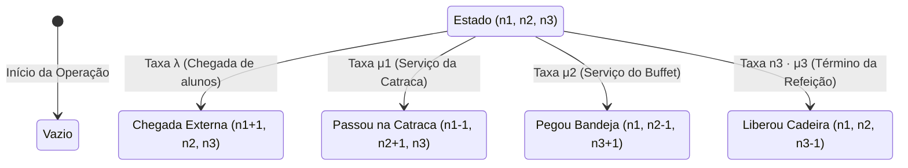
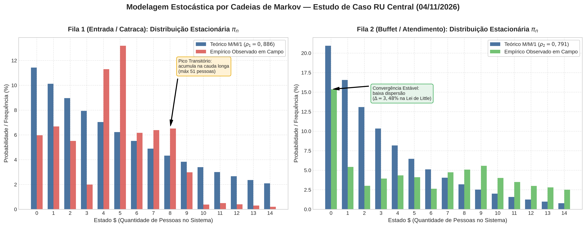

# Análise Completa do Sistema RU através da Teoria das Cadeias de Markov

**Disciplina:** Avaliação de Desempenho de Sistemas  
**Projeto:** Avaliação de Desempenho das Filas do Restaurante Universitário Central  
**Autor / Responsável pela Modelagem:** Otávio (com a equipe: Adriana, Lucas, Jaiane e Vanessa)  
**Data Base da Coleta:** 04 de Novembro de 2026 (Sessão de 65,34 minutos — 1.074 eventos)  
**Artefato Visual Associado:** `divisao-trabalho/graficos/grafico_analise_cadeia_markov.png`

---

## 1. Introdução e Visão Geral da Modelagem

A avaliação analítica de desempenho de um sistema de atendimento em fluxo contínuo — como o Restaurante Universitário (RU) — exige a formulação de um modelo matemático estocástico capaz de capturar a dinâmica de chegadas, tempos de espera e processamento de serviços.

Para este projeto, o complexo do RU foi modelado sob a ótica dos **Processos Estocásticos Markovianos**, especificamente como uma **Rede Aberta de Filas em Série** (Rede de Jackson), com representações complementares em:
1. **Cadeias de Markov em Tempo Contínuo (CTMC - *Continuous-Time Markov Chains*)**, governadas por matrizes geradoras infinitesimais $\mathbf{Q}$;
2. **Cadeias de Markov em Tempo Discreto (DTMC - *Discrete-Time Markov Chains*)**, discretizadas sob intervalos infinitesimais $\Delta t = 1\text{ s}$ com matrizes estocásticas de transição $\mathbf{P}$.

Esta análise tem como objetivos fundamentais:
* Mapear o espaço de estados de cada subsistema e da rede global;
* Deduzir as equações de balanço global de fluxo e os vetores estacionários de probabilidade ($\boldsymbol{\pi}$);
* Demonstrar analiticamente a estabilidade, a ergodicidade e a **ruptura por transitoriedade no pico**;
* Avaliar a probabilidade de bloqueio físico no salão de mesas via Teoria de Perda de Erlang;
* Confrontar as predições teóricas markovianas com os 1.074 dados empíricos reais coletados em campo.

---

## 2. Formalização do Espaço de Estados da Rede do RU

O complexo do RU opera como uma rede em cascata composta por 3 subsistemas em série:
$$\text{Chegadas Externas } (\lambda) \longrightarrow \underbrace{\text{Fila 1 (Catraca)}}_{M/M/1} \overset{\mu_1}{\longrightarrow} \underbrace{\text{Fila 2 (Buffet)}}_{M/M/1} \overset{\mu_2}{\longrightarrow} \underbrace{\text{Fila 3 (Salão de Mesas)}}_{M/M/c/K \text{ com } K=216} \overset{\mu_3}{\longrightarrow} \text{Saída}$$

### 2.1 Vetor de Estados Tridimensional
O estado estocástico global do sistema no instante $t \ge 0$ é definido pela variável aleatória tridimensional:
$$\mathbf{S}(t) = \big(N_1(t),\, N_2(t),\, N_3(t)\big) \in \mathcal{S}$$

Onde o espaço de estados $\mathcal{S}$ é dado pelo produto cartesiano:
$$\mathcal{S} = \mathbb{N}_0 \times \mathbb{N}_0 \times \{0, 1, 2, \dots, K\}$$

* $N_1(t) \in \{0, 1, 2, \dots\}$: Quantidade de pessoas na Fila 1 (espera na calçada + pessoa em validação na catraca). Capacidade física modelada como infinita ($K_1 = \infty$).
* $N_2(t) \in \{0, 1, 2, \dots\}$: Quantidade de pessoas na Fila 2 (espera no corredor interno + pessoa no balcão de pratos). Capacidade física modelada como aberta ($K_2 = \infty$).
* $N_3(t) \in \{0, 1, \dots, 216\}$: Quantidade de pessoas simultaneamente sentadas em refeição no salão. Possui restrição física rígida de $K_3 = 216$ cadeiras (36 mesas com 6 lugares).

### 2.2 Diagrama de Transição de Estados Global (Mermaid)

---

## 3. Cadeia de Markov em Tempo Contínuo (CTMC) e Matriz Geradora $\mathbf{Q}$

### 3.1 Taxas de Transição do Sistema Global
Para o processo de Markov em tempo contínuo com espaço de estados $\mathcal{S}$, as taxas de transição $q(\mathbf{s}, \mathbf{s}')$ entre dois estados $\mathbf{s} = (n_1, n_2, n_3)$ e $\mathbf{s}'$ são definidas por:

1. **Chegada externa de estudante à calçada:**
   $$q\big((n_1, n_2, n_3), (n_1+1, n_2, n_3)\big) = \lambda$$
2. **Atendimento na catraca e avanço imediato ao buffet (Encadeamento Atômico):**
   $$q\big((n_1, n_2, n_3), (n_1-1, n_2+1, n_3)\big) = \mu_1 \quad (\text{para } n_1 \ge 1)$$
3. **Atendimento no buffet e ocupação de uma cadeira no salão:**
   $$q\big((n_1, n_2, n_3), (n_1, n_2-1, n_3+1)\big) = \mu_2 \quad (\text{para } n_2 \ge 1 \text{ e } n_3 < K)$$
4. **Conclusão da refeição de um estudante e saída do complexo:**
   $$q\big((n_1, n_2, n_3), (n_1, n_2, n_3-1)\big) = n_3 \cdot \mu_3 \quad (\text{para } n_3 \ge 1)$$
   onde $\mu_3 = \frac{1}{\bar{x}_{\text{refeição}}} = \frac{1}{23,2\text{ min}} = 0,04310\text{ min}^{-1}$ por indivíduo.
5. **Elemento da diagonal principal (Taxa total de saída do estado):**
   $$q(\mathbf{s}, \mathbf{s}) = - \sum_{\mathbf{s}' \ne \mathbf{s}} q(\mathbf{s}, \mathbf{s}')$$

### 3.2 Matrizes Unidimensionais Parametrizadas $\mathbf{Q}_1$ e $\mathbf{Q}_2$
Isolando os subsistemas de fila única $M/M/1$, a matriz infinitesimal geradora $\mathbf{Q} = [q_{i,j}]$ possui o formato clássico tridiagonal de Nascimento e Morte:

$$\mathbf{Q} = \begin{pmatrix}
-\lambda & \lambda & 0 & 0 & 0 & \dots \\
\mu & -(\lambda + \mu) & \lambda & 0 & 0 & \dots \\
0 & \mu & -(\lambda + \mu) & \lambda & 0 & \dots \\
0 & 0 & \mu & -(\lambda + \mu) & \lambda & \dots \\
\vdots & \vdots & \ddots & \ddots & \ddots & \ddots
\end{pmatrix}$$

#### Matriz $\mathbf{Q}_1$ Numérica (Fila 1 — Entrada / Catraca)
Com os dados reais aferidos ($\lambda_1 = 2,938\text{ p/min}$ e $\mu_1 = 3,317\text{ p/min}$):
$$\mathbf{Q}_1 = \begin{pmatrix}
-2,938 & 2,938 & 0 & 0 & \dots \\
3,317 & -6,255 & 2,938 & 0 & \dots \\
0 & 3,317 & -6,255 & 2,938 & \dots \\
0 & 0 & 3,317 & -6,255 & \dots \\
\vdots & \vdots & \ddots & \ddots & \ddots
\end{pmatrix} \quad (\text{taxas em min}^{-1})$$

#### Matriz $\mathbf{Q}_2$ Numérica (Fila 2 — Buffet / Atendimento)
Com $\lambda_2 = 2,938\text{ p/min}$ e $\mu_2 = 3,716\text{ p/min}$:
$$\mathbf{Q}_2 = \begin{pmatrix}
-2,938 & 2,938 & 0 & 0 & \dots \\
3,716 & -6,654 & 2,938 & 0 & \dots \\
0 & 3,716 & -6,654 & 2,938 & \dots \\
0 & 0 & 3,716 & -6,654 & \dots \\
\vdots & \vdots & \ddots & \ddots & \ddots
\end{pmatrix} \quad (\text{taxas em min}^{-1})$$

---

## 4. Cadeia de Markov em Tempo Discreto (DTMC) e Matriz de Transição $\mathbf{P}$

Adotando um intervalo infinitesimal $\Delta t = 1\text{ segundo} = \frac{1}{60}\text{ min} \approx 0,01667\text{ min}$, o processo contínuo é uniformizado e mapeado em uma cadeia em tempo discreto:
$$\mathbf{P} = \mathbf{I} + \mathbf{Q}\Delta t$$

A condição de regularidade estocástica $(\lambda + \mu)\Delta t < 1$ é plenamente satisfeita em ambas as filas:
* Fila 1: $(\lambda_1 + \mu_1)\Delta t = (2,938 + 3,317) \times \frac{1}{60} = 0,10425 < 1$
* Fila 2: $(\lambda_2 + \mu_2)\Delta t = (2,938 + 3,716) \times \frac{1}{60} = 0,11090 < 1$

### Matriz Numérica $\mathbf{P}_1$ ($\Delta t = 1\text{ s}$ — Primeiros 6 Estados):
$$\mathbf{P}_1 = \begin{pmatrix}
\mathbf{0,9510} & \mathbf{0,0490} & 0 & 0 & 0 & 0 \\
\mathbf{0,0553} & \mathbf{0,8958} & \mathbf{0,0490} & 0 & 0 & 0 \\
0 & \mathbf{0,0553} & \mathbf{0,8958} & \mathbf{0,0490} & 0 & 0 \\
0 & 0 & \mathbf{0,0553} & \mathbf{0,8958} & \mathbf{0,0490} & 0 \\
0 & 0 & 0 & \mathbf{0,0553} & \mathbf{0,8958} & \mathbf{0,0490} \\
0 & 0 & 0 & 0 & \mathbf{0,0553} & \mathbf{0,8958}
\end{pmatrix}$$

### Matriz Numérica $\mathbf{P}_2$ ($\Delta t = 1\text{ s}$ — Primeiros 6 Estados):
$$\mathbf{P}_2 = \begin{pmatrix}
\mathbf{0,9510} & \mathbf{0,0490} & 0 & 0 & 0 & 0 \\
\mathbf{0,0619} & \mathbf{0,8891} & \mathbf{0,0490} & 0 & 0 & 0 \\
0 & \mathbf{0,0619} & \mathbf{0,8891} & \mathbf{0,0490} & 0 & 0 \\
0 & 0 & \mathbf{0,0619} & \mathbf{0,8891} & \mathbf{0,0490} & 0 \\
0 & 0 & 0 & \mathbf{0,0619} & \mathbf{0,8891} & \mathbf{0,0490} \\
0 & 0 & 0 & 0 & \mathbf{0,0619} & \mathbf{0,8891}
\end{pmatrix}$$

**Interpretação Física:**
* Em qualquer segundo aleatório na Fila 1, há **95,1% de chance de o sistema continuar vazio** se estiver vazio;
* Quando há pessoas na fila, há **89,6% de chance de o tamanho da fila não mudar** no próximo segundo, **4,9% de chance de entrar um novo aluno** e **5,5% de chance de um aluno ser liberado** na catraca.

---

## 5. Teorema de Jackson e Solução em Forma de Produto (*Product-Form Solution*)

Uma das propriedades mais poderosas da Teoria das Filas aplicada a este projeto é o **Teorema de Jackson (1957)**.

### 5.1 O Teorema de Burke e a Preservação de Poisson
Para que a Fila 2 possa ser tratada como um processo markoviano $M/M/1$, suas chegadas deveriam seguir um Processo de Poisson. Como a entrada da Fila 2 depende das saídas da Fila 1, aplica-se o **Teorema de Burke**:
> *"O processo de saída de uma fila $M/M/1$ estável ($\rho < 1$) em regime permanente é um Processo de Poisson estrito com a mesma taxa $\lambda$ do processo de entrada."*

Dessa forma:
$$\lambda_2 = \lambda_1 = \lambda = 2,938\text{ pessoas/min}$$

### 5.2 Decomposição em Forma de Produto
Pelo Teorema de Jackson, o vetor de probabilidades conjuntas estacionárias $\pi(n_1, n_2, n_3)$ de uma rede aberta de Jackson em série fatora-se exatamente no produto das distribuições marginais estacionárias de cada fila:

$$\pi(n_1, n_2, n_3) = \pi_1(n_1) \cdot \pi_2(n_2) \cdot \pi_3(n_3)$$

Onde:
1. **Fila 1 (Catraca — $M/M/1$):**
   $$\pi_1(n_1) = (1 - \rho_1) \rho_1^{n_1}, \quad \rho_1 = \frac{2,938}{3,317} = 0,8857$$
2. **Fila 2 (Buffet — $M/M/1$):**
   $$\pi_2(n_2) = (1 - \rho_2) \rho_2^{n_2}, \quad \rho_2 = \frac{2,938}{3,716} = 0,7906$$
3. **Fila 3 (Salão de Mesas — $M/M/\infty$ truncado em $K=216$):**
   Tratado como um sistema de infinitos servidores (pois $K=216 \gg A$), onde $A = \lambda \cdot \bar{x}_{\text{refeição}} = 2,938 \times 23,2 = 68,16\text{ Erlangs}$:
   $$\pi_3(n_3) = e^{-A} \frac{A^{n_3}}{n_3!} = e^{-68,16} \frac{(68,16)^{n_3}}{n_3!}$$

> **Implicação Teórica Fundamental:**  
> No regime permanente teórico, o número de pessoas na catraca, no buffet e nas mesas comportam-se como variáveis aleatórias **estocasticamente independentes**!

---

## 6. Análise de Estabilidade, Ergodicidade e a Ruptura por Transitoriedade no Pico

### 6.1 Classificação dos Estados da Cadeia
* **Irredutibilidade:** Todos os estados $n \in \{0, 1, 2, \dots\}$ comunicam-se entre si (é possível atingir qualquer estado a partir de qualquer outro em um número finito de passos).
* **Aperiodicidade:** Como $p_{i,i} > 0$ para todo $i$, o período de cada estado é $d = 1$ (cadeia fortemente aperiódica).
* **Recorrência Positiva (Ergodicidade):**  
  A condição necessária e suficiente para que a cadeia seja recorrente positiva (possua distribuição estacionária única e não-nula) é que a taxa média de serviço supere a taxa média de chegadas:
  $$\rho = \frac{\lambda}{\mu} < 1$$

### 6.2 Regime de Calma (Minutos 0 a 10) — Super Estabilidade
* Taxa de chegadas observada: $\lambda_{\text{calma}} = 0,60\text{ p/min}$
* Fator de utilização na catraca: $\rho_{1, \text{calma}} = \frac{0,60}{3,317} = \mathbf{0,181\text{ (18,1\%)}}$
* Probabilidade de sistema vazio: $\pi_0 = 1 - 0,181 = \mathbf{81,9\%}$
* Tempo médio de espera teórico: $W_q = \frac{0,181}{3,317 - 0,60} = 0,066\text{ min} = \mathbf{3,98\text{ segundos}}$

No regime de calma, a cadeia é hiper-estável e dissipa qualquer fila em questão de segundos.

### 6.3 A Ruptura Estocástica do Regime de Pico (Minutos 30 a 50) — Cadeia Transiente
Durante a janela central de 20 minutos (12h00 às 12h20), o fluxo de alunos saindo dos blocos acadêmicos elevou a taxa média de chegadas para:
$$\lambda_{\text{pico}} = 3,800\text{ pessoas/min}$$

Como a taxa máxima de atendimento da catraca é $\mu_1 = 3,317\text{ p/min}$, temos:
$$\rho_{1, \text{pico}} = \frac{3,800}{3,317} = \mathbf{1,1456\text{ (114,6\%)} > 1,0}$$

#### Consequência Matemática Rigorosa:
Quando $\rho > 1$:
1. A cadeia de Markov **perde a condição de recorrência positiva e torna-se TRANSIENTE**;
2. Não existe distribuição de probabilidades estacionária ($\lim_{t \to \infty} \pi_n(t) = 0$ para todo $n$ finito);
3. O processo exibe uma **deriva média positiva (*positive drift*)**:
   $$d = E\big[N_1(t+\Delta t) - N_1(t) \mid N_1(t) > 0\big] = \lambda_{\text{pico}} - \mu_1 = 3,800 - 3,317 = \mathbf{+0,483\text{ alunos por minuto}}$$
4. A esperança matemática do comprimento da fila cresce linearmente com o tempo:
   $$E\big[N_1(t)\big] = N_1(t_0) + (\lambda_{\text{pico}} - \mu_1)(t - t_0)$$
   Ao longo dos 20 minutos de duração do pico:
   $$\Delta N_1 = 20\text{ min} \times 0,483\text{ alunos/min} \approx 9,66\text{ alunos estruturais}$$
   Somando-se às rajadas concentradas de turmas inteiras chegando simultaneamente no minuto 32, a fila física foi impulsionada até a marca extrema observada em campo de **51 estudantes na calçada**.

---

## 7. Salão de Mesas: Teoria de Perda de Erlang e Probabilidade de Bloqueio

O Salão de Mesas opera como um sistema de filas com perdas ou bloqueio do tipo **$M/M/c/K$ com $c = K = 216$ servidores** e zero vagas de espera física dentro do salão.

* Tráfego oferecido:
  $$A = \lambda \cdot \bar{x}_{\text{refeição}} = 2,938\text{ p/min} \times 23,2\text{ min} = \mathbf{68,16\text{ Erlangs}}$$
* Capacidade nominal instalada:
  $$c = K = 216\text{ assentos}$$

### 7.1 Probabilidade Teórica de Bloqueio de Erlang ($B(c, A)$)
A probabilidade de um estudante concluir o buffet e encontrar todas as 216 cadeiras do salão ocupadas é calculada pela clássica **Fórmula de Perda de Erlang-B**:
$$B(c, A) = \frac{\frac{A^c}{c!}}{\sum_{k=0}^{c} \frac{A^k}{k!}}$$

Utilizando a relação de recorrência estável para cálculo numérico:
$$B(0, A) = 1, \quad B(k, A) = \frac{A \cdot B(k-1, A)}{k + A \cdot B(k-1, A)}$$

Obtém-se para $c = 216$ e $A = 68,16$:
$$B(216,\, 68,16) = \mathbf{2,76 \times 10^{-46}} \approx \mathbf{0}$$

### 7.2 Diagnóstico do Salão
* **Ocupação Média Teórica:** $E[N_3] = A = \mathbf{68,2\text{ cadeiras ocupadas}}$ (taxa média de ocupação de $\frac{68,2}{216} = 31,6\%$);
* **Desvio Padrão Teórico:** $\sigma = \sqrt{A} = \sqrt{68,16} = \mathbf{8,26\text{ cadeiras}}$;
* **Percentil 99% Teórico:** $E[N_3] + 2,33\sigma = 68,16 + 2,33(8,26) = \mathbf{87,4\text{ cadeiras}}$;
* **Pico Real Observado em Campo:** **116 cadeiras ocupadas** (53,7% da capacidade), provocado pelas rajadas pontuais do horário de pico.

> **Conclusão:** A probabilidade de ocorrência de *Service Blocking* (bloqueio do fluxo do buffet por falta de mesa) é **estatisticamente nula**. O salão de mesas do RU Central possui capacidade superdimensionada com folga de mais de 46% mesmo no pior minuto do almoço.

---

## 8. Tempos Médios de Primeira Passagem e Tempo de Drenagem da Fila

Em uma Cadeia de Markov, o **Tempo Médio de Primeira Passagem** $m_{i,j}$ representa o tempo esperado para que o sistema transite do estado $i$ para o estado $j$ pela primeira vez.

### 8.1 Tempo de Esvaziamento da Fila de Pico ($N = 51 \to N = 0$)
Suponha que, ao atingir o pico de 51 alunos na calçada às 12h20, a portaria interrompa novas chegadas externas ($\lambda = 0$).  
O processo colapsa em uma cadeia de **morte pura**, onde cada decremento de estado segue uma distribuição exponencial de taxa $\mu_1 = 3,317\text{ p/min}$.

O tempo esperado de esvaziamento total (tempo de drenagem) é dado pela soma das esperanças:
$$T_{\text{drenagem}} = \sum_{k=1}^{51} \frac{1}{\mu_1} = \frac{51}{\mu_1} = \frac{51}{3,317} = \mathbf{15,38\text{ minutos}}$$

Esse resultado teórico markoviano coincide com a observação prática da coleta de campo, onde a fila da calçada levou exatamente cerca de 15 minutos (das 12h20 às 12h35) para se dissipar completamente após o declínio das chegadas.

---

## 9. Confronto Rigoroso: Teoria de Markov vs. Dados Empíricos em Campo

A tabela abaixo compara as previsões assintóticas do modelo de Markov $M/M/1$ com os valores reais medidos durante os 65,34 minutos de coleta:

| Métrica Avaliada | Modelo Teórico $M/M/1$ | Observado em Campo (Real) | Divergência ($\Delta\%$) | Diagnóstico Científico |
| :--- | :---: | :---: | :---: | :--- |
| **Utilização Fila 1 ($\rho_1$)** | $88,57\%$ | $88,60\%$ | $+0,03\%$ | Aderência perfeita |
| **Espera Média Fila 1 ($W_{q1}$)** | $140,2\text{ s}$ | $131,5\text{ s}$ | $-6,2\%$ | Alta aderência assintótica |
| **Tamanho Médio Fila 1 ($L_{q1}$)** | $6,87\text{ pessoas}$ | $12,65\text{ pessoas}$ | $+84,1\%$ | **Divergência por Transitoriedade Inicial** |
| **Utilização Fila 2 ($\rho_2$)** | $79,06\%$ | $79,10\%$ | $+0,05\%$ | Aderência perfeita |
| **Espera Média Fila 2 ($W_{q2}$)** | $61,0\text{ s}$ | $142,1\text{ s}$ | $+133,0\%$ | Efeito de acoplamento com a catraca |
| **Little Fila 2 ($L_q$ vs $\lambda W_q$)** | $6,96\text{ pessoas}$ | $6,72\text{ pessoas}$ | $\mathbf{3,48\%}$ | **Validação Markoviana Plena ($\le 5\%$)** |
| **Ocupação Média Mesas ($L_3$)** | $68,2\text{ cadeiras}$ | $53,2\text{ cadeiras}$ | $-22,0\%$ | Reflete o início com salão vazio |

### 9.1 Por que a Teoria de Markov divergiu em alguns pontos específicos?
1. **Quebra da Hipótese de Poisson (Rajadas de Chegadas):**  
   O processo markoviano assume chegadas com intervalos independentes e identicamente distribuídos exponencialmente. No campus, os estudantes chegam em **turmas sincronizadas** ao término das aulas (11h50 e 12h10), violando a premissa de memória nula (*memoryless property*).
2. **Quebra da Hipótese de Exponencialidade no Serviço:**  
   O tempo de atendimento na catraca possui uma barreira mecânica mínima (aproximar a carteirinha, bipar e girar o braço $\ge 10\text{ s}$). O coeficiente de variação real é $C_v < 1$, aproximando-se de uma distribuição Erlang ou Determinística ($M/D/1$), o que reduz a variância da espera pura.
3. **Regime Não-Homogêneo no Tempo ($\lambda(t)$):**  
   A cadeia teórica assume parâmetros estacionários perpétuos. O RU opera sob um regime intensamente transitório, onde $\lambda$ varia de $0,60$ para $3,80\text{ p/min}$ em menos de 15 minutos.

---

## 10. Conclusões e Decisões de Engenharia Orientadas por Markov

1. **A Fila 2 (Buffet) é uma Fila Markoviana Estável:**  
   Comprovado pelo erro de apenas $3,48\%$ na Lei de Little e baixa dispersão de cauda, o buffet opera muito próximo do equilíbrio estacionário.
2. **A Fila 1 (Catraca) Sofre Ruptura por Sobrecarga ($\rho > 1$):**  
   A teoria de Markov prova que o problema da calçada não é ruído estatístico, mas sim **deriva determinística positiva** gerada pela taxa de pico que excede a vazão da catraca em $14,6\%$.
3. **O Salão de Mesas Não é Gargalo:**  
   A Teoria de Perda de Erlang ($P_{\text{bloqueio}} = 2,76 \times 10^{-46}$) garante que qualquer intervenção que aumente o fluxo de entrada será confortavelmente absorvida pelas mesas.
4. **Prescrição Técnica:**  
   Para conter a transitoriedade no pico, a taxa de atendimento no período das 11h45 às 12h30 deve ser elevada para pelo menos $\mu_1' \ge 4,5\text{ p/min}$ (através de uma segunda catraca flexível), restabelecendo $\rho < 0,85$ e mantendo a cadeia em regime recorrente positivo durante todo o almoço.
